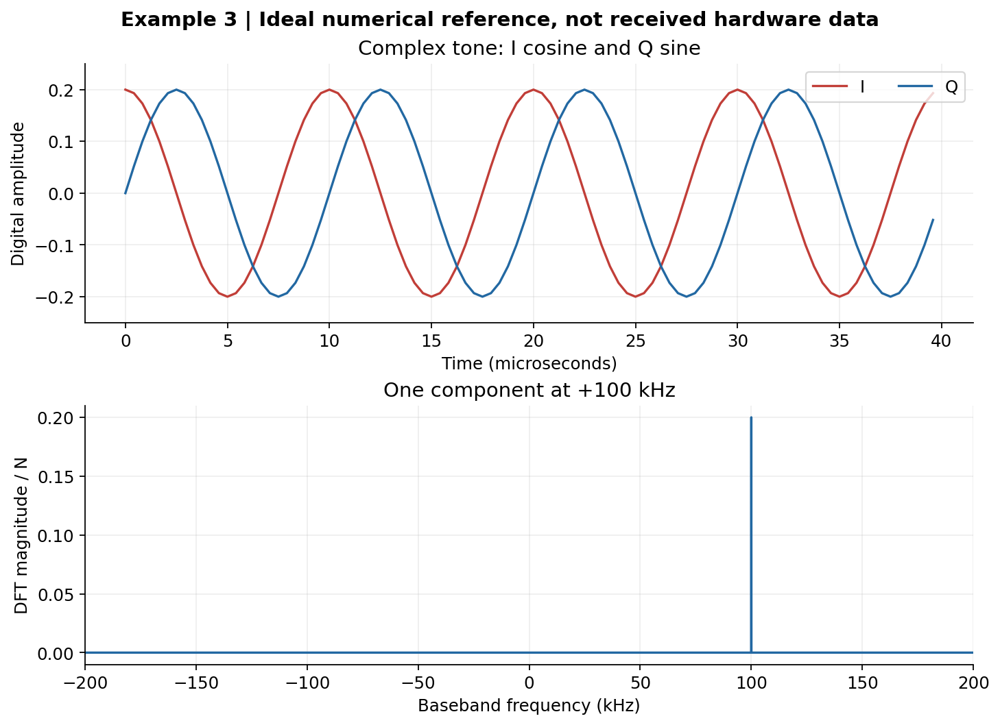

# Example 3 — Known-tone transmission and reception

## Purpose and project connection

Establish a controlled one-TX/one-RX link. Prove which spectral peak is yours using on/off behavior and a deliberate frequency change. This directly supports the robot-beacon measurement chain; it does not by itself estimate robot coordinates.

## Requirements and prerequisites

Complete the TX-off baseline. Use both laptops and Plutos with the approved RF arrangement.

## Hardware setup and operating rules

This example targets **GNU Radio 3.10.12.0 / Python 3.12.9**, using the native **PlutoSDR Source / PlutoSDR Sink** blocks from `gnuradio.iio`, not Soapy substitutes. Laptop A has the transmitting Pluto, connected to its **TX** port. Laptop B has the receiving Pluto, connected to its **RX** port. Each laptop sees its own radio; they do not need to share one USB address.

1. Unzip the complete package. Keep each example's folders together.
2. Open the relevant `.grc` file using **File → Open** in GNU Radio Companion. The file in `flowgraphs/` is the editable circuit. Do not open `REPORT.md` as a circuit.
3. Identify the radio on each laptop. In the same terminal/environment used for GNU Radio, run `iio_info -s`. The default `device_uri` is `'ip:192.168.2.1'`. If that does not reach your device, replace it with the exact discovered URI, quoted as a Python string, for example `'usb:1.2.3'` only if that is the URI actually reported. Do not copy an example USB address blindly.
4. The numeric LO default is **2450000000 Hz**, solely a design reference for a supervisor-approved conducted/shielded setup. It is not a statement that transmitting there is authorized. For over-the-air tests use the frequency and operating conditions approved for your lab and location. Put the same approved `rf_center` on TX and RX. Do not directly cable TX into RX without a suitable approved attenuation arrangement; obtain the arrangement from your lab's hardware limits.
5. TX starts at **60 dB attenuation** and digital tone amplitude **0.2**. RX starts in **Manual** gain mode at **20 dB**. These are conservative starting settings, not guaranteed received levels. If the signal is too weak, diagnose URI/frequency/TX state first, then adjust one gain/attenuation setting while recording it. Stop if clipping, broad unwanted products or saturation appears.
6. Leave `samp_rate = 2400000`, Buffer size `32768`, Cyclic `False` on TX, and Filter Configuration `Off` for these supplied graphs. TX requests RF bandwidth 1 MHz; the upstream 3.10.12 RX Source implementation uses its internal 20 MHz default in this mode (see COMPATIBILITY.md). The receiver's **digital captured span is still 2.4 MHz**, and later digital channel filtering is much narrower. Do not claim that the RX UI field independently set an exact analog bandwidth. Hardware readback is still needed to verify actual settings.
7. Run **Generate** and then **Execute**. Record the first error if either fails. Start RX first; observe TX-off; then start TX. Stop TX first when finishing. There is no Throttle in hardware graphs: the radios provide pacing.
8. Two independent Plutos have frequency error. Before narrow-channel examples, use Example 3's full-span RX graph to measure the actual beacon/carrier peak. Set `channel_offset` in the narrow RX graph to that **measured baseband frequency**, not blindly to 100000. Aim for residual offset within about 500 Hz for the audio experiment. Change settings with the graph stopped, regenerate, and rerun.

All RF spectra are labeled in **baseband Hz**, not absolute RF Hz. The reference RF frequency is `rf_center + baseband_frequency`. The selected-channel plot is relative to the selected channel center. RX waveform plots may autoscale to make a weak signal visible; that does not prove its power is unchanged. Power comparisons use explicit measurements with constant gain.

Actual hardware results are blank until you run the test. Synthetic figures in `results/`, when present, are labeled numerical reference simulations. No generated reference image is a GNU Radio screenshot or a Pluto measurement.

## New concepts

**Complex tone** means I is a cosine and Q is a sine, representing one signed baseband frequency. **Frequency offset** is a difference between expected and measured carrier locations, including oscillator errors. **TX attenuation** reduces radio output: a larger attenuation setting means less transmit output. It is not the same sign convention as positive RX gain.

## Circuit files and signal paths

All block names below correspond to the saved `.grc` files. Variables are grouped above the signal path. Processing runs left to right; monitoring branches appear below or after the relevant stage.

### ex03_rx_tone.grc

| Block ID | Block / role | Input → output | Rate information |
| --- | --- | --- | --- |
| `radio_rx` | iio_pluto_source: Receive digital I/Q from the local Pluto. | RF / radio device → Complex float32 | samp_rate = 2400000 samples/s |
| `received_spectrum` | qtgui_freq_sink_x: Show frequency content with the stated bandwidth/FFT; not calibrated dBm. | complex → GUI | bandwidth samp_rate; FFT 4096 |
| `received_iq` | qtgui_time_sink_x: Show time-domain shape; autoscale is only for visibility where enabled. | complex → GUI | display rate samp_rate; 256 points |

### ex03_tx_tone.grc

| Block ID | Block / role | Input → output | Rate information |
| --- | --- | --- | --- |
| `beacon` | analog_sig_source_x: Generate the named tone or positive AM envelope. | none → complex | samp_rate; frequency beacon_offset |
| `radio_tx` | iio_pluto_sink: Send the digital I/Q stream through the local Pluto TX. | Complex float32 → RF / radio device | samp_rate = 2400000 samples/s |
| `tx_spectrum` | qtgui_freq_sink_x: Show frequency content with the stated bandwidth/FFT; not calibrated dBm. | complex → GUI | bandwidth samp_rate; FFT 4096 |

Rate map: all envelope/carrier/complex conversion/multiplication streams in this TX circuit use 2.4 Msample/s. In AM TX circuits, tx_monitor translates and decimates a separate display-only branch to 48 ksample/s so the spectrum can show sidebands clearly; the actual RF input remains at 2.4 Msample/s.

All TX streams are Complex 2.4 Msample/s. RX is Complex 2.4 Msample/s; Time Sink displays its I and Q components.

## Important configuration: value, reason and effect

| Parameter | Value | Reason and effect of changes |
| --- | --- | --- |
| beacon_offset | 100000 Hz | Avoids zero-frequency artifacts; moving it should move the received peak. |
| tx_amplitude | 0.2 digital units | Keeps the complex tone comfortably below normalized full-scale components. |
| tx_atten_db | 60 dB | Low initial output; decrease only in recorded steps if needed. |
| RX/TX LO | same approved value | Puts the expected beacon near +100 kHz on RX. |
| RX Time Sink | 256 complex samples; autoscale | Shows I and Q shape over about 106.667 microseconds; not a power comparison. |
| RX FFT | 4096, Hann | Full-span identification, with 585.9375 Hz spacing. |

## Step-by-step execution

1. Open `ex03_rx_tone.grc` on B and `ex03_tx_tone.grc` on A. Apply the hardware setup and identical approved LOs.
2. Start B only. Record the TX-off spectrum.
3. Start A. Find a new/stronger narrow peak near +100 kHz, allowing for the radios' frequency difference.
4. Stop A. Check that this peak decreases or disappears. Restart A and repeat. A residual floor/peak is possible; compare change rather than demanding exact zero.
5. Stop A, change `beacon_offset` to 125000, regenerate and run. The identified peak should move by about +25000 Hz. Restore 100000 afterward.
6. Record the received peak frequency f_peak. Compute `offset_error = f_peak - 100000`. This is the value needed to center the later AM/beacon receiver; use the actual peak itself as `channel_offset` there.
7. Observe I/Q. Autoscale lets you see a weak waveform, so use it for shape only. Record that each component oscillates and has approximately a quarter-cycle phase relation for a clean tone.
8. Stop TX, then RX.

## Expected results

TX digital spectrum: one complex component at +100 kHz. RX: near +100 kHz plus unknown offset, channel attenuation and noise. Deliberately increasing TX offset by 25 kHz moves the corresponding received peak about +25 kHz. The absolute received amplitude cannot be calculated without the channel and gain calibration.

## Verification: evidence to collect

Record at least two TX-off/on transitions and the +25 kHz shift while other settings stay fixed. An identified component should follow both controls. Do not use a visible peak alone as proof.

## Guided experiments

Predict each change, run it, observe, and explain the difference from your prediction. Change one variable at a time.

First change only offset from 100 to 125 kHz. Then restore it and halve tx_amplitude from 0.2 to 0.1; predict about −6.02 dB in digital signal power under a stable linear link, allowing for the noise floor. Restore baseline. Do not use the autoscaled waveform height to assess this power change.

## Troubleshooting

| Symptom | Possible cause | How to check | Correction |
| --- | --- | --- | --- |
| No new peak | Wrong LO/URI, TX not running, weak link or large offset | Check TX local spectrum, radio errors and RX full span | Match settings; use approved gain/attenuation adjustments one at a time. |
| Peak near zero stays when TX stops | An unrelated component or DC artifact | Apply the 25 kHz TX offset test | Identify the feature that follows the deliberate change. |
| Peak frequency differs from 100 kHz | Independent oscillators or incorrect LO | Measure f_peak; compare TX/RX LO fields | Record offset; use measured channel_offset later. |
| Many new spectral products | Clipping/overload or an excessive source amplitude | Reduce gain or increase TX attenuation | Recover a linear regime before collecting data. |

## Understanding check — try before the answers

1. Where is a +100 kHz complex tone transmitted if LO is 2450 MHz?
2. Why use +100 kHz rather than 0?
3. Why is the received amplitude not necessarily 0.2?
4. How do you prove a peak is yours?

## Answers

1. Approximately 2450.1 MHz in this reference design.
2. To separate the intended tone from potential center-frequency artifacts.
3. The RF channel, hardware gain, noise and scaling intervene.
4. Controlled TX-off/on and an offset change with the predicted received shift.

## Completion criteria

You can run RX before TX, prove reception through two controls, explain I/Q versus RF, and record the carrier offset for a later narrow-channel receiver.

## Your results worksheet

These fields are for your observations. Do not copy reference simulations into the measured-results column.

| Run / single changed variable | Prediction | LO / offset / rates | Gain / attenuation / amplitude | Measurement and units | Variability / error | Interpretation |
| --- | --- | --- | --- | --- | --- | --- |
| Baseline | ___ | ___ | ___ | ___ | ___ | ___ |
| Controlled change 1 | ___ | ___ | ___ | ___ | ___ | ___ |
| Restored baseline | ___ | ___ | ___ | ___ | ___ | ___ |
| Controlled change 2 | ___ | ___ | ___ | ___ | ___ | ___ |

Keep screenshots only when they demonstrate a specific criterion, with the relevant settings recorded. Read REPORT.md for the engineering explanation and equations.

## Reference illustration — numerical simulation

