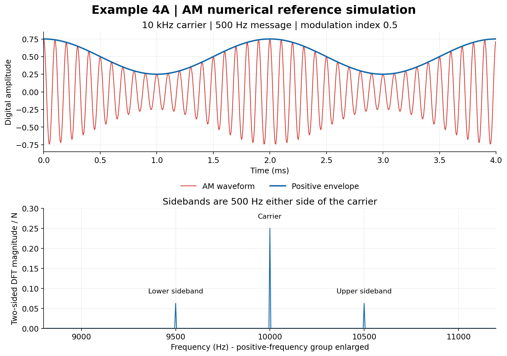

# Example 4 — See AM, then transmit and recover a sinusoidal message

## Purpose and project connection

First understand AM visually, like the supplied illustration. Then transmit the same principle between two Plutos and verify that the recovered message has the correct frequency. This directly supports the robot-beacon measurement chain; it does not by itself estimate robot coordinates.

## Requirements and prerequisites

Complete the known-tone link, including carrier identification and offset measurement. Start with 4A, which needs no radio.

## Hardware setup and operating rules

**Skip this section for the first simulation (4A or 6A). Apply it only when you move to the two-radio files.**

This example targets **GNU Radio 3.10.12.0 / Python 3.12.9**, using the native **PlutoSDR Source / PlutoSDR Sink** blocks from `gnuradio.iio`, not Soapy substitutes. Laptop A has the transmitting Pluto, connected to its **TX** port. Laptop B has the receiving Pluto, connected to its **RX** port. Each laptop sees its own radio; they do not need to share one USB address.

1. Unzip the complete package. Keep each example's folders together.
2. Open the relevant `.grc` file using **File → Open** in GNU Radio Companion. The file in `flowgraphs/` is the editable circuit. Do not open `REPORT.md` as a circuit.
3. Identify the radio on each laptop. In the same terminal/environment used for GNU Radio, run `iio_info -s`. The default `device_uri` is `'ip:192.168.2.1'`. If that does not reach your device, replace it with the exact discovered URI, quoted as a Python string, for example `'usb:1.2.3'` only if that is the URI actually reported. Do not copy an example USB address blindly.
4. The numeric LO default is **2450000000 Hz**, solely a design reference for a supervisor-approved conducted/shielded setup. It is not a statement that transmitting there is authorized. For over-the-air tests use the frequency and operating conditions approved for your lab and location. Put the same approved `rf_center` on TX and RX. Do not directly cable TX into RX without a suitable approved attenuation arrangement; obtain the arrangement from your lab's hardware limits.
5. TX starts at **60 dB attenuation** and digital tone amplitude **0.2**. RX starts in **Manual** gain mode at **20 dB**. These are conservative starting settings, not guaranteed received levels. If the signal is too weak, diagnose URI/frequency/TX state first, then adjust one gain/attenuation setting while recording it. Stop if clipping, broad unwanted products or saturation appears.
6. Leave `samp_rate = 2400000`, Buffer size `32768`, Cyclic `False` on TX, and Filter Configuration `Off` for these supplied graphs. TX requests RF bandwidth 1 MHz; the upstream 3.10.12 RX Source implementation uses its internal 20 MHz default in this mode (see COMPATIBILITY.md). The receiver's **digital captured span is still 2.4 MHz**, and later digital channel filtering is much narrower. Do not claim that the RX UI field independently set an exact analog bandwidth. Hardware readback is still needed to verify actual settings.
7. Run **Generate** and then **Execute**. Record the first error if either fails. Start RX first; observe TX-off; then start TX. Stop TX first when finishing. There is no Throttle in hardware graphs: the radios provide pacing.
8. Two independent Plutos have frequency error. Before narrow-channel examples, use Example 3's full-span RX graph to measure the actual beacon/carrier peak. Set `channel_offset` in the narrow RX graph to that **measured baseband frequency**, not blindly to 100000. Aim for residual offset within about 500 Hz for the audio experiment. Change settings with the graph stopped, regenerate, and rerun.

All RF spectra are labeled in **baseband Hz**, not absolute RF Hz. The reference RF frequency is `rf_center + baseband_frequency`. The selected-channel plot is relative to the selected channel center. RX waveform plots may autoscale to make a weak signal visible; that does not prove its power is unchanged. Power comparisons use explicit measurements with constant gain.

Actual hardware results are blank until you run the test. Synthetic figures in `results/`, when present, are labeled numerical reference simulations. No generated reference image is a GNU Radio screenshot or a Pluto measurement.

## New concepts

**Envelope** is the slowly changing outer amplitude boundary. **Modulation index mu** controls the depth of its variation. **Sidebands** carry message-dependent frequency components. **Envelope detector** computes complex magnitude. **Decimation by 50** means output rate is input rate divided by 50, with filtering to avoid aliasing. **DC removal** removes the constant carrier-related envelope level; it is not channel selection.

## Circuit files and signal paths

All block names below correspond to the saved `.grc` files. Variables are grouped above the signal path. Processing runs left to right; monitoring branches appear below or after the relevant stage.

### ex04a_am_visual.grc

| Block ID | Block / role | Input → output | Rate information |
| --- | --- | --- | --- |
| `positive_envelope` | analog_sig_source_x: Generate the named tone or positive AM envelope. | none → float | samp_rate; frequency message_hz |
| `simulation_clock` | blocks_throttle2: Pace a simulation; do not resample. | same stream type → same stream type | same source rate samp_rate |
| `visual_carrier` | analog_sig_source_x: Generate the named tone or positive AM envelope. | none → float | samp_rate; frequency visual_carrier_hz |
| `am_product` | blocks_multiply_xx: Multiply envelope by carrier or combine complex frequency shifts. | two same-rate Float or Complex streams → same type/rate | same input rate; see rate map below |
| `am_and_envelope` | qtgui_time_sink_x: Show time-domain shape; autoscale is only for visibility where enabled. | float → GUI | display rate samp_rate; 768 points |
| `spectrum_rate_conversion` | low_pass_filter: Restrict the message, select the test tone, or reduce only the visual spectrum branch rate. | Float input → Float | 192000 → 48000 samples/s; decimation 4; display branch only |
| `am_spectrum` | qtgui_freq_sink_x: Show frequency content with the stated bandwidth/FFT; not calibrated dBm. | float → GUI | bandwidth spectrum_rate; FFT 4096 |

Rate map: the AM/carrier/envelope streams are Float at 192 ksample/s. The time display compares two inputs at that same rate. A display-only low-pass decimates by 4 to 48 ksample/s for the spectrum, keeping its axes truthful while making the 500 Hz sideband spacing visible.

### ex04b_tx_am.grc

| Block ID | Block / role | Input → output | Rate information |
| --- | --- | --- | --- |
| `am_envelope` | analog_sig_source_x: Generate the named tone or positive AM envelope. | none → float | samp_rate; frequency message_hz |
| `envelope_as_iq` | blocks_float_to_complex: Represent a real envelope as a complex stream before frequency shifting. | Float I; optional Q left unconnected → Complex I+j0 at the same rate | same input rate; see rate map below |
| `offset_carrier` | analog_sig_source_x: Generate the named tone or positive AM envelope. | none → complex | samp_rate; frequency beacon_offset |
| `shift_away_from_dc` | blocks_multiply_xx: Multiply envelope by carrier or combine complex frequency shifts. | two same-rate Float or Complex streams → same type/rate | same input rate; see rate map below |
| `radio_tx` | iio_pluto_sink: Send the digital I/Q stream through the local Pluto TX. | Complex float32 → RF / radio device | samp_rate = 2400000 samples/s |
| `tx_monitor` | freq_xlating_fir_filter_xxx: Translate/filter/decimate a display-only TX branch; the RF stream stays at 2.4 Msample/s. | Complex at 2400000 samples/s → Complex at 48000 samples/s | 2400000 → 48000 samples/s; center beacon_offset |
| `tx_spectrum` | qtgui_freq_sink_x: Show frequency content with the stated bandwidth/FFT; not calibrated dBm. | complex → GUI | bandwidth monitor_rate; FFT 4096 |

Rate map: all envelope/carrier/complex conversion/multiplication streams in this TX circuit use 2.4 Msample/s. In AM TX circuits, tx_monitor translates and decimates a separate display-only branch to 48 ksample/s so the spectrum can show sidebands clearly; the actual RF input remains at 2.4 Msample/s.

### ex04c_rx_am.grc

| Block ID | Block / role | Input → output | Rate information |
| --- | --- | --- | --- |
| `radio_rx` | iio_pluto_source: Receive digital I/Q from the local Pluto. | RF / radio device → Complex float32 | samp_rate = 2400000 samples/s |
| `select_beacon` | freq_xlating_fir_filter_xxx: Translate the measured beacon, filter and decimate by 50. | Complex at 2400000 samples/s → Complex at 48000 samples/s | 2400000 → 48000 samples/s; center channel_offset |
| `envelope_detector` | blocks_complex_to_mag: Take magnitude to recover the positive AM envelope. | Complex → Float | as stated in input/output columns |
| `remove_carrier_dc` | dc_blocker_xx: Remove the constant envelope component; allow settling. | Float at 48000 samples/s → Float at 48000 samples/s | as stated in input/output columns |
| `selected_spectrum` | qtgui_freq_sink_x: Show frequency content with the stated bandwidth/FFT; not calibrated dBm. | complex → GUI | bandwidth channel_rate; FFT 4096 |
| `recovered_message` | qtgui_time_sink_x: Show time-domain shape; autoscale is only for visibility where enabled. | float → GUI | display rate channel_rate; 384 points |

Rate map: Pluto RX → selecting filter: Complex 2.4 Msample/s. Selecting-filter output and AM magnitude/DC/listening stages where present: 48 ksample/s. The power averaging chain stays at 48 ksample/s until Keep 1 in N, whose reports are about 10/s. The logger reads selected Complex 48 ksample/s directly.

Read the exact rate map below each circuit table before changing sample rates. Display settings label a stream; they do not convert its rate.

## Important configuration: value, reason and effect

| Parameter | Value | Reason and effect of changes |
| --- | --- | --- |
| 4A simulation rate | 192000 samples/s | Makes the 10 kHz carrier smooth enough to inspect. |
| 4A carrier/message | 10000 / 500 Hz | 20 carrier cycles per message cycle; the envelope stays recognizable. |
| 4A carrier_amplitude / mu | 0.5 / 0.5 | Envelope remains between 0.25 and 0.75; no overmodulation. |
| 4A time display | 768 samples; 4 ms; red AM + blue positive envelope | Exactly two meaningful curves, plus one spectrum panel. |
| 4B carrier/message | 100000 Hz offset / 1000 Hz message | Connects to the known beacon; expected sideband spacing is 1 kHz. |
| 4B carrier_amplitude / mu | 0.25 / 0.5 | Envelope 0.125–0.375; leaves TX digital headroom. |
| 4C select_beacon | cutoff 5000 Hz, transition 3000 Hz, decimation 50 | Translate the measured carrier to near zero and keep its sidebands; output 48 ksample/s. |
| 4C DC Blocker | Length 1024; Long Form True | Remove carrier-related DC after envelope detection; allow startup settling. |

## Step-by-step execution

1. Open and run `ex04a_am_visual.grc` on either laptop. It is a simulation; connect no Pluto. The top plot has red AM samples and a blue upper envelope. The lower plot shows frequency content. Start here until you can identify both.
2. Confirm envelope maximum 0.75 and minimum 0.25. Measure its 2 ms period (500 Hz). Find positive-frequency spectral peaks near 9500, 10000 and 10500 Hz; their negative-frequency mirrors belong to the same real signal.
3. Change only modulation_index to 0, then 0.8. Predict the envelope before running; restore 0.5. Do not use mu > 1 for the hardware step.
4. On laptop A open `ex04b_tx_am.grc`. On B use Example 3's full-span receiver first. Apply approved hardware settings. Start RX, then TX, and measure the AM carrier near +100 kHz. The TX local plot is a selected digital monitor: carrier at 0 Hz and sidebands ±1 kHz. Its display-only branch translates/filters/decimates to 48 ksample/s; it does not alter the RF input. It is not evidence of RF reception.
5. Stop RX, open `ex04c_rx_am.grc` on B, and set channel_offset to the **measured AM carrier frequency in baseband**. Match the approved LO. Run B with A transmitting.
6. The selected-channel spectrum should show the carrier near 0 Hz and sidebands roughly 1 kHz either side. Its span is now ±24 kHz, not ±1.2 MHz.
7. The recovered-message time plot should have approximately 1 ms period. Its amplitude depends on the channel. Autoscale is enabled to show weak signals; do not compare power from its apparent height.
8. Change only TX message_hz to 2000. Predict a 0.5 ms recovered period and ±2 kHz sideband spacing. Check both, then restore 1000. Stop TX then RX.

## Expected results

4A: envelope 0.25–0.75, message 500 Hz, carrier 10 kHz, sidebands 9.5 and 10.5 kHz. 4B: envelope 0.125–0.375; complex carrier 100 kHz, sidebands 99 and 101 kHz. Each sideband is ideally about 12.04 dB below the carrier in power. 4C: recovered 1 kHz message, with unknown channel-dependent amplitude and startup/filter delay.

## Verification: evidence to collect

4A must match envelope extrema and sideband positions. The hardware test must pass TX-on/off identification, show the AM sideband spacing, and recover the selected message frequency. Confirm the 1 kHz → 2 kHz controlled change in both the selected spectrum and recovered period.

## Guided experiments

Predict each change, run it, observe, and explain the difference from your prediction. Change one variable at a time.

Use 4A for mu = 0, 0.5 and 0.8, changing no other setting; predict minimum/maximum envelope first. In hardware, change only message frequency from 1 to 2 kHz. If studying overmodulation later, do it in simulation and compare mathematical envelope sign with absolute magnitude; do not infer that the blue signed expression remains the true envelope when it crosses zero.

## Troubleshooting

| Symptom | Possible cause | How to check | Correction |
| --- | --- | --- | --- |
| 4A envelope looks detached from AM | Wrong multiplier/offset or different rates | Verify all 4A blocks share samp_rate and the envelope branch feeds both paths | Restore the supplied graph and mu 0.5. |
| Hardware RX has no recovered signal | Carrier not within the narrow channel | Use full-span Example 3 RX to find it | Set channel_offset to the actual peak; rerun. |
| Message frequency is correct but shape distorted | Overmodulation, clipping, mistuning or filtering | Check mu ≤ 1, TX amplitude and selected spectrum; reduce gain/output | Restore baseline, re-center and operate linearly. |
| Recovered waveform initially drifts | Filter/DC-blocker settling | Wait about one second before measuring | Compare steady-state data, not startup. |
| Four real-spectrum groups confuse you | Positive and negative frequency mirrors | Start from the positive 9.5, 10, 10.5 kHz group | Interpret negative frequencies as the mirror of this real AM signal. |

## Understanding check — try before the answers

1. What changes in AM?
2. Why add a positive constant before modulation?
3. Why is Complex to Mag not enough by itself?
4. Why is the 10 kHz visual carrier not our actual RF LO?

## Answers

1. The carrier amplitude follows the message; its nominal carrier frequency remains fixed.
2. It supplies the carrier and keeps the envelope positive for ordinary envelope recovery.
3. It retains a DC envelope level and includes whatever enters its channel; selection and DC removal serve different purposes.
4. It is a deliberately slowed simulation carrier for learning; hardware RF is produced by the Pluto LO plus the digital offset.

## Completion criteria

You can identify message, carrier, envelope and sidebands, calculate mu from extrema, explain each receiver stage, and prove that the recovered frequency follows a controlled message change.

## Your results worksheet

These fields are for your observations. Do not copy reference simulations into the measured-results column.

| Run / single changed variable | Prediction | LO / offset / rates | Gain / attenuation / amplitude | Measurement and units | Variability / error | Interpretation |
| --- | --- | --- | --- | --- | --- | --- |
| Baseline | ___ | ___ | ___ | ___ | ___ | ___ |
| Controlled change 1 | ___ | ___ | ___ | ___ | ___ | ___ |
| Restored baseline | ___ | ___ | ___ | ___ | ___ | ___ |
| Controlled change 2 | ___ | ___ | ___ | ___ | ___ | ___ |

Keep screenshots only when they demonstrate a specific criterion, with the relevant settings recorded. Read REPORT.md for the engineering explanation and equations.

## Reference illustration — numerical simulation

