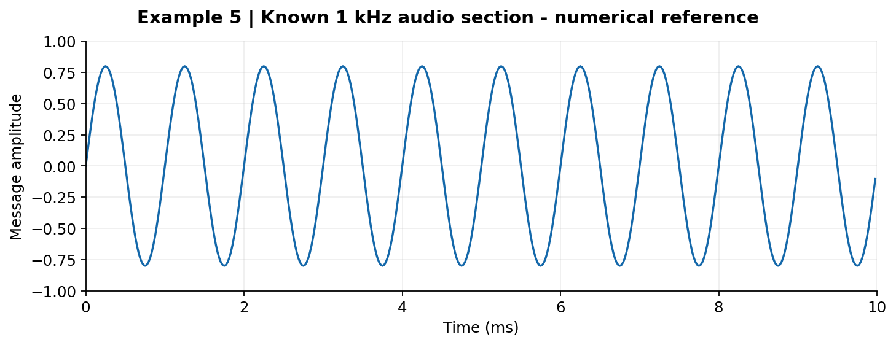

# Example 5 — Transmit and recover an AM audio clip

## Purpose and project connection

Send a known three-tone audio clip before trying a voice recording. Verify rates and recovered pitch with a predictable test instead of relying only on hearing an arbitrary sound. This directly supports the robot-beacon measurement chain; it does not by itself estimate robot coordinates.

## Requirements and prerequisites

Complete 4A–4C, including carrier centering and recovered 1 kHz verification. Both laptops/Plutos and speakers/headphones on B are required.

## Hardware setup and operating rules

This example targets **GNU Radio 3.10.12.0 / Python 3.12.9**, using the native **PlutoSDR Source / PlutoSDR Sink** blocks from `gnuradio.iio`, not Soapy substitutes. Laptop A has the transmitting Pluto, connected to its **TX** port. Laptop B has the receiving Pluto, connected to its **RX** port. Each laptop sees its own radio; they do not need to share one USB address.

1. Unzip the complete package. Keep each example's folders together.
2. Open the relevant `.grc` file using **File → Open** in GNU Radio Companion. The file in `flowgraphs/` is the editable circuit. Do not open `REPORT.md` as a circuit.
3. Identify the radio on each laptop. In the same terminal/environment used for GNU Radio, run `iio_info -s`. The default `device_uri` is `'ip:192.168.2.1'`. If that does not reach your device, replace it with the exact discovered URI, quoted as a Python string, for example `'usb:1.2.3'` only if that is the URI actually reported. Do not copy an example USB address blindly.
4. The numeric LO default is **2450000000 Hz**, solely a design reference for a supervisor-approved conducted/shielded setup. It is not a statement that transmitting there is authorized. For over-the-air tests use the frequency and operating conditions approved for your lab and location. Put the same approved `rf_center` on TX and RX. Do not directly cable TX into RX without a suitable approved attenuation arrangement; obtain the arrangement from your lab's hardware limits.
5. TX starts at **60 dB attenuation** and digital tone amplitude **0.2**. RX starts in **Manual** gain mode at **20 dB**. These are conservative starting settings, not guaranteed received levels. If the signal is too weak, diagnose URI/frequency/TX state first, then adjust one gain/attenuation setting while recording it. Stop if clipping, broad unwanted products or saturation appears.
6. Leave `samp_rate = 2400000`, Buffer size `32768`, Cyclic `False` on TX, and Filter Configuration `Off` for these supplied graphs. TX requests RF bandwidth 1 MHz; the upstream 3.10.12 RX Source implementation uses its internal 20 MHz default in this mode (see COMPATIBILITY.md). The receiver's **digital captured span is still 2.4 MHz**, and later digital channel filtering is much narrower. Do not claim that the RX UI field independently set an exact analog bandwidth. Hardware readback is still needed to verify actual settings.
7. Run **Generate** and then **Execute**. Record the first error if either fails. Start RX first; observe TX-off; then start TX. Stop TX first when finishing. There is no Throttle in hardware graphs: the radios provide pacing.
8. Two independent Plutos have frequency error. Before narrow-channel examples, use Example 3's full-span RX graph to measure the actual beacon/carrier peak. Set `channel_offset` in the narrow RX graph to that **measured baseband frequency**, not blindly to 100000. Aim for residual offset within about 500 Hz for the audio experiment. Change settings with the graph stopped, regenerate, and rerun.

All RF spectra are labeled in **baseband Hz**, not absolute RF Hz. The reference RF frequency is `rf_center + baseband_frequency`. The selected-channel plot is relative to the selected channel center. RX waveform plots may autoscale to make a weak signal visible; that does not prove its power is unchanged. Power comparisons use explicit measurements with constant gain.

Actual hardware results are blank until you run the test. Synthetic figures in `results/`, when present, are labeled numerical reference simulations. No generated reference image is a GNU Radio screenshot or a Pluto measurement.

## New concepts

**WAV** here is mono 16-bit PCM audio at 48000 samples/s. **Interpolation** creates a higher-rate representation with filtering; it is not just relabeling samples. **Listening gain** scales the recovered audio for the sound output; it does not calibrate received RF power. **Underrun** means a device did not receive data in time; it is distinct from a modulation error.

## Circuit files and signal paths

All block names below correspond to the saved `.grc` files. Variables are grouped above the signal path. Processing runs left to right; monitoring branches appear below or after the relevant stage.

### ex05_rx_audio.grc

| Block ID | Block / role | Input → output | Rate information |
| --- | --- | --- | --- |
| `radio_rx` | iio_pluto_source: Receive digital I/Q from the local Pluto. | RF / radio device → Complex float32 | samp_rate = 2400000 samples/s |
| `select_beacon` | freq_xlating_fir_filter_xxx: Translate the measured beacon, filter and decimate by 50. | Complex at 2400000 samples/s → Complex at 48000 samples/s | 2400000 → 48000 samples/s; center channel_offset |
| `envelope_detector` | blocks_complex_to_mag: Take magnitude to recover the positive AM envelope. | Complex → Float | as stated in input/output columns |
| `remove_carrier_dc` | dc_blocker_xx: Remove the constant envelope component; allow settling. | Float at 48000 samples/s → Float at 48000 samples/s | as stated in input/output columns |
| `listening_gain` | blocks_multiply_const_vxx: Apply the documented modulation or listening scale. | Float → Float at same rate | same input rate; see rate map below |
| `speakers` | audio_sink: Play recovered audio; volume is not RF calibration. | Float at 48000 samples/s → sound device | as stated in input/output columns |
| `selected_spectrum` | qtgui_freq_sink_x: Show frequency content with the stated bandwidth/FFT; not calibrated dBm. | complex → GUI | bandwidth channel_rate; FFT 4096 |
| `recovered_message` | qtgui_time_sink_x: Show time-domain shape; autoscale is only for visibility where enabled. | float → GUI | display rate channel_rate; 384 points |

Rate map: Pluto RX → selecting filter: Complex 2.4 Msample/s. Selecting-filter output and AM magnitude/DC/listening stages where present: 48 ksample/s. The power averaging chain stays at 48 ksample/s until Keep 1 in N, whose reports are about 10/s. The logger reads selected Complex 48 ksample/s directly.

### ex05_tx_audio.grc

| Block ID | Block / role | Input → output | Rate information |
| --- | --- | --- | --- |
| `test_audio` | blocks_wavfile_source: Read the supplied known audio sequence repeatedly. | mono WAV file → Float at file rate, here 48000 samples/s | as stated in input/output columns |
| `limit_audio_band` | low_pass_filter: Restrict the message, select the test tone, or reduce only the visual spectrum branch rate. | Float input → Float | audio_rate = 48000 |
| `audio_to_radio_rate` | rational_resampler_xxx: Interpolate by 50 with anti-imaging filtering. | Float at 48000 samples/s → Float at 2400000 samples/s | as stated in input/output columns |
| `set_modulation_depth` | blocks_multiply_const_vxx: Apply the documented modulation or listening scale. | Float → Float at same rate | same input rate; see rate map below |
| `add_carrier` | blocks_add_const_vxx: Add the constant AM carrier envelope. | Float → Float at same rate | same input rate; see rate map below |
| `envelope_as_iq` | blocks_float_to_complex: Represent a real envelope as a complex stream before frequency shifting. | Float I; optional Q left unconnected → Complex I+j0 at the same rate | same input rate; see rate map below |
| `offset_carrier` | analog_sig_source_x: Generate the named tone or positive AM envelope. | none → complex | samp_rate; frequency beacon_offset |
| `shift_away_from_dc` | blocks_multiply_xx: Multiply envelope by carrier or combine complex frequency shifts. | two same-rate Float or Complex streams → same type/rate | same input rate; see rate map below |
| `radio_tx` | iio_pluto_sink: Send the digital I/Q stream through the local Pluto TX. | Complex float32 → RF / radio device | samp_rate = 2400000 samples/s |
| `tx_monitor` | freq_xlating_fir_filter_xxx: Translate/filter/decimate a display-only TX branch; the RF stream stays at 2.4 Msample/s. | Complex at 2400000 samples/s → Complex at 48000 samples/s | 2400000 → 48000 samples/s; center beacon_offset |
| `tx_spectrum` | qtgui_freq_sink_x: Show frequency content with the stated bandwidth/FFT; not calibrated dBm. | complex → GUI | bandwidth monitor_rate; FFT 4096 |

Rate map: WAV → audio LPF: Float 48 ksample/s; Rational Resampler output → scale → add constant → Float To Complex → complex multiply → Pluto TX: 2.4 Msample/s. The offset carrier is also Complex at 2.4 Msample/s.

Read the exact rate map below each circuit table before changing sample rates. Display settings label a stream; they do not convert its rate.

## Important configuration: value, reason and effect

| Parameter | Value | Reason and effect of changes |
| --- | --- | --- |
| WAV file | assets/test_audio_48k.wav | Generated known test clip: 500, 1000 and 1500 Hz, each 2 s followed by 0.5 s silence; total 7.5 s. |
| audio_rate | 48000 samples/s | Matches the provided file and Audio Sink. |
| Audio LPF | cutoff 3000 Hz; transition 1000 Hz; no decimation | Limits message bandwidth before upsampling and modulation. |
| Rational Resampler | Float→Float; interpolation 50; decimation 1; fractional BW 0.4 | Converts 48 ksample/s to 2.4 Msample/s with anti-imaging filtering. |
| carrier_amplitude / modulation_index | 0.25 / 0.5 | At message peak 0.8, effective depth is approximately 0.4; envelope remains positive. |
| RX channel | measured center; decimation 50 to 48000 samples/s | Returns selected RF baseband to the audio processing rate. |
| audio_gain | 10.0 initially | May need adjustment to hear a weak signal; keep sound output below clipping. |

## Step-by-step execution

1. Play `assets/test_audio_48k.wav` locally once so you know the intended three pitches and silences.
2. On A open `ex05_tx_audio.grc`. In **Wav File Source → File**, browse to the included WAV and select it. This avoids working-directory differences; do not depend on the initial relative path if GRC runs elsewhere.
3. On B first use the full-span receiver to locate the AM carrier while A transmits under the approved setup. Stop B, open `ex05_rx_audio.grc`, and put that measured baseband carrier frequency into channel_offset. For a 3 kHz audio band, center within about 500 Hz to retain useful passband margin.
4. Set computer/headphone volume low. Start B, then A. Wait at least one second for DC removal/filter settling.
5. Listen for the three increasing pitches and 0.5 s quiet intervals. The top RX plot shows recovered audio; the lower plot shows the selected channel, not the full 2.4 MHz capture.
6. During the 1000 Hz section, measure approximately 1 ms between recovered cycles; during 500 Hz expect 2 ms and during 1500 Hz about 0.6667 ms. Record each section. Noise may remain during a silent message because the carrier is still on.
7. If sound is weak, increase audio_gain in recorded steps with TX/RX RF settings fixed. If clipping or harsh distortion appears, lower it. Do not add a Throttle to repair sound-buffer errors.
8. Only after the known clip passes, substitute a **mono 48 kHz PCM WAV** voice recording with sensible peak level and no clipping. Browse to it and rerun. This is a voice-file demonstration; a live microphone is a separate extension.
9. Stop TX, then RX.

## Expected results

A repeating 7.5 s three-tone sequence with correct pitch order and duration, delayed and attenuated by the chain. With a peak-normalized test message of 0.8 and mu setting 0.5, the envelope is approximately 0.15–0.35 before small filter/resampler transients. Audio silence leaves the AM carrier present, so silence is not equivalent to TX-off.

## Verification: evidence to collect

Correct 500/1000/1500 Hz recovered periods plus the expected order and quiet intervals. Compare a TX-off run to rule out unrelated audio. Hearing intelligible speech is a later check, not the only proof of rate correctness.

## Guided experiments

Predict each change, run it, observe, and explain the difference from your prediction. Change one variable at a time.

Change only audio_gain; pitch must stay the same. Replace the message with a known 1 kHz mono 48 kHz WAV; it must still recover as 1 kHz. Compare a silent interval with stopping TX: the former retains carrier power, the latter should reduce it. Restore the supplied clip before diagnosing a new fault.

## Troubleshooting

| Symptom | Possible cause | How to check | Correction |
| --- | --- | --- | --- |
| WAV cannot open | Relative path points to wrong directory | Use File Browse and verify the full path | Select the included WAV explicitly. |
| Wrong pitch or playback duration | Audio rate/resampling mismatch | Inspect WAV rate, interpolation 50, hardware 2.4 M and RX decimation 50 | Restore the complete rate chain; changing sink labels is not resampling. |
| Carrier visible but audio absent | Mistuned channel, too little listening gain or sound-device issue | Check selected carrier/sidebands and recovered time plot before speakers | Re-center; adjust audio gain; verify the chosen system output. |
| Distorted or harsh audio | Clipping, excessive listening gain, RF overload or message peaks | Reduce audio_gain first; inspect source amplitude and RF levels separately | Restore headroom and make one change per run. |
| Audio underruns / intermittent sound | Processing load, USB stalls or independent device clocks | Inspect console messages, close heavy apps and compare short runs | Use short tests and stable USB; do not add competing rate-control blocks. |

## Understanding check — try before the answers

1. Why interpolate by 50?
2. Does a silent audio interval turn the transmitter off?
3. Is audio_gain an RF power calibration?
4. Why start with test tones before voice?

## Answers

1. 2400000/48000 = 50; the sample representation must match the radio stream rate.
2. No. Ordinary AM retains its carrier when the message is zero.
3. No. It is only digital listening gain after demodulation.
4. Known pitch, duration and silence make rate and signal-path faults measurable.

## Completion criteria

You can trace every rate from WAV to radio and back, recover known pitches, diagnose a path/volume/rate error, and explain why silence is not TX-off.

## Your results worksheet

These fields are for your observations. Do not copy reference simulations into the measured-results column.

| Run / single changed variable | Prediction | LO / offset / rates | Gain / attenuation / amplitude | Measurement and units | Variability / error | Interpretation |
| --- | --- | --- | --- | --- | --- | --- |
| Baseline | ___ | ___ | ___ | ___ | ___ | ___ |
| Controlled change 1 | ___ | ___ | ___ | ___ | ___ | ___ |
| Restored baseline | ___ | ___ | ___ | ___ | ___ | ___ |
| Controlled change 2 | ___ | ___ | ___ | ___ | ___ | ___ |

Keep screenshots only when they demonstrate a specific criterion, with the relevant settings recorded. Read REPORT.md for the engineering explanation and equations.

## Reference illustration — numerical simulation

