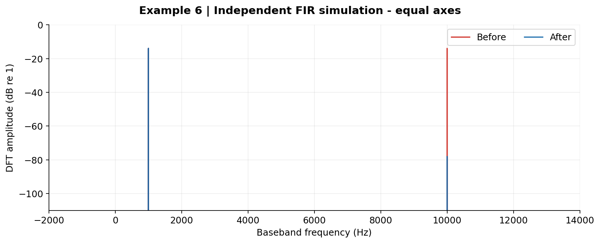

# Example 6 — Filtering and selecting the beacon

## Purpose and project connection

Learn filtering on a controlled two-tone simulation, then select the real beacon with the same translate/filter/decimate reasoning. This directly supports the robot-beacon measurement chain; it does not by itself estimate robot coordinates.

## Requirements and prerequisites

Complete the known-tone link and AM examples. 6A needs one laptop only; the hardware pair uses both Plutos.

## Hardware setup and operating rules

**Skip this section for the first simulation (4A or 6A). Apply it only when you move to the two-radio files.**

This example targets **GNU Radio 3.10.12.0 / Python 3.12.9**, using the native **PlutoSDR Source / PlutoSDR Sink** blocks from `gnuradio.iio`, not Soapy substitutes. Laptop A has the transmitting Pluto, connected to its **TX** port. Laptop B has the receiving Pluto, connected to its **RX** port. Each laptop sees its own radio; they do not need to share one USB address.

1. Unzip the complete package. Keep each example's folders together.
2. Open the relevant `.grc` file using **File → Open** in GNU Radio Companion. The file in `flowgraphs/` is the editable circuit. Do not open `REPORT.md` as a circuit.
3. Identify the radio on each laptop. In the same terminal/environment used for GNU Radio, run `iio_info -s`. The default `device_uri` is `'ip:192.168.2.1'`. If that does not reach your device, replace it with the exact discovered URI, quoted as a Python string, for example `'usb:1.2.3'` only if that is the URI actually reported. Do not copy an example USB address blindly.
4. The numeric LO default is **2450000000 Hz**, solely a design reference for a supervisor-approved conducted/shielded setup. It is not a statement that transmitting there is authorized. For over-the-air tests use the frequency and operating conditions approved for your lab and location. Put the same approved `rf_center` on TX and RX. Do not directly cable TX into RX without a suitable approved attenuation arrangement; obtain the arrangement from your lab's hardware limits.
5. TX starts at **60 dB attenuation** and digital tone amplitude **0.2**. RX starts in **Manual** gain mode at **20 dB**. These are conservative starting settings, not guaranteed received levels. If the signal is too weak, diagnose URI/frequency/TX state first, then adjust one gain/attenuation setting while recording it. Stop if clipping, broad unwanted products or saturation appears.
6. Leave `samp_rate = 2400000`, Buffer size `32768`, Cyclic `False` on TX, and Filter Configuration `Off` for these supplied graphs. TX requests RF bandwidth 1 MHz; the upstream 3.10.12 RX Source implementation uses its internal 20 MHz default in this mode (see COMPATIBILITY.md). The receiver's **digital captured span is still 2.4 MHz**, and later digital channel filtering is much narrower. Do not claim that the RX UI field independently set an exact analog bandwidth. Hardware readback is still needed to verify actual settings.
7. Run **Generate** and then **Execute**. Record the first error if either fails. Start RX first; observe TX-off; then start TX. Stop TX first when finishing. There is no Throttle in hardware graphs: the radios provide pacing.
8. Two independent Plutos have frequency error. Before narrow-channel examples, use Example 3's full-span RX graph to measure the actual beacon/carrier peak. Set `channel_offset` in the narrow RX graph to that **measured baseband frequency**, not blindly to 100000. Aim for residual offset within about 500 Hz for the audio experiment. Change settings with the graph stopped, regenerate, and rerun.

All RF spectra are labeled in **baseband Hz**, not absolute RF Hz. The reference RF frequency is `rf_center + baseband_frequency`. The selected-channel plot is relative to the selected channel center. RX waveform plots may autoscale to make a weak signal visible; that does not prove its power is unchanged. Power comparisons use explicit measurements with constant gain.

Actual hardware results are blank until you run the test. Synthetic figures in `results/`, when present, are labeled numerical reference simulations. No generated reference image is a GNU Radio screenshot or a Pluto measurement.

## New concepts

**Passband** is the range intended to pass with small change. **Stopband** is the range intended to attenuate. **Transition width** is the gradual region between them. **Filter taps** are the coefficients of a weighted sum of samples. **Group delay** means the filtered signal is delayed; it does not indicate that the source frequency changed.

## Circuit files and signal paths

All block names below correspond to the saved `.grc` files. Variables are grouped above the signal path. Processing runs left to right; monitoring branches appear below or after the relevant stage.

### ex06_rx_selection.grc

| Block ID | Block / role | Input → output | Rate information |
| --- | --- | --- | --- |
| `radio_rx` | iio_pluto_source: Receive digital I/Q from the local Pluto. | RF / radio device → Complex float32 | samp_rate = 2400000 samples/s |
| `select_beacon` | freq_xlating_fir_filter_xxx: Translate the measured beacon, filter and decimate by 50. | Complex at 2400000 samples/s → Complex at 48000 samples/s | 2400000 → 48000 samples/s; center channel_offset |
| `selected_spectrum` | qtgui_freq_sink_x: Show frequency content with the stated bandwidth/FFT; not calibrated dBm. | complex → GUI | bandwidth channel_rate; FFT 4096 |

Rate map: Pluto RX → selecting filter: Complex 2.4 Msample/s. Selecting-filter output and AM magnitude/DC/listening stages where present: 48 ksample/s. The power averaging chain stays at 48 ksample/s until Keep 1 in N, whose reports are about 10/s. The logger reads selected Complex 48 ksample/s directly.

### ex06_tx_beacon.grc

| Block ID | Block / role | Input → output | Rate information |
| --- | --- | --- | --- |
| `beacon` | analog_sig_source_x: Generate the named tone or positive AM envelope. | none → complex | samp_rate; frequency beacon_offset |
| `radio_tx` | iio_pluto_sink: Send the digital I/Q stream through the local Pluto TX. | Complex float32 → RF / radio device | samp_rate = 2400000 samples/s |
| `tx_spectrum` | qtgui_freq_sink_x: Show frequency content with the stated bandwidth/FFT; not calibrated dBm. | complex → GUI | bandwidth samp_rate; FFT 4096 |

Rate map: all envelope/carrier/complex conversion/multiplication streams in this TX circuit use 2.4 Msample/s. In AM TX circuits, tx_monitor translates and decimates a separate display-only branch to 48 ksample/s so the spectrum can show sidebands clearly; the actual RF input remains at 2.4 Msample/s.

### ex06a_filter_simulation.grc

| Block ID | Block / role | Input → output | Rate information |
| --- | --- | --- | --- |
| `desired_tone` | analog_sig_source_x: Generate the named tone or positive AM envelope. | none → complex | samp_rate; frequency desired_hz |
| `unwanted_tone` | analog_sig_source_x: Generate the named tone or positive AM envelope. | none → complex | samp_rate; frequency unwanted_hz |
| `combined_input` | blocks_add_xx: Add the controlled desired/unwanted test tones. | two same-rate Complex streams → Complex at 48000 samples/s | as stated in input/output columns |
| `simulation_clock` | blocks_throttle2: Pace a simulation; do not resample. | same stream type → same stream type | same source rate samp_rate |
| `select_low_frequency` | low_pass_filter: Restrict the message, select the test tone, or reduce only the visual spectrum branch rate. | Complex input → Complex | samp_rate = 48000; decimation 1 |
| `before_after` | qtgui_freq_sink_x: Show frequency content with the stated bandwidth/FFT; not calibrated dBm. | complex → GUI | bandwidth samp_rate; FFT 4096 |

Read the exact rate map below each circuit table before changing sample rates. Display settings label a stream; they do not convert its rate.

## Important configuration: value, reason and effect

| Parameter | Value | Reason and effect of changes |
| --- | --- | --- |
| 6A rate / tones | 48000 samples/s; +1000 and +10000 Hz | Both fit in ±24 kHz; one is well inside the selected low-frequency region and one far outside. |
| 6A tone amplitudes | 0.2 each | Equal initial levels make rejection easy to compare. |
| 6A Low Pass Filter | Complex→Complex; cutoff 3000 Hz; transition 2000 Hz; Hamming; decimation 1 | No rate change in the comparison, so both traces have identical axes. |
| 6A comparison display | one panel; red before / blue after | Shows only the information needed to judge selection. |
| Hardware selection | measured channel_offset; cutoff 5000 Hz; transition 3000 Hz; D=50 | Shift the beacon to near zero, reject other bands and produce 48 ksample/s. |

## Step-by-step execution

1. Run `ex06a_filter_simulation.grc` without hardware. There is one spectrum panel with two traces on identical axes.
2. Before filtering (red), identify components near +1 kHz and +10 kHz. After filtering (blue), the +1 kHz component should remain while +10 kHz decreases strongly.
3. Let startup settle. Record both frequencies and the before/after GUI levels using the same FFT and window. The tones are off the FFT grid, so a single-bin level is only approximate.
4. Change only unwanted_hz from 10000 to 4000, then 3000. Observe the transition region. Do not expect an infinitely sharp edge at the cutoff. Restore 10000.
5. For hardware, open `ex06_tx_beacon.grc` on A. Use the full-span receiver to find the actual carrier. Then stop B and open `ex06_rx_selection.grc` with channel_offset set to that measured peak.
6. Start the selected receiver then TX. Its one spectrum now spans ±24 kHz and should show the beacon near zero. Confirm TX-off/on behavior.
7. To understand mistuning, stop B and shift channel_offset by +1000 Hz while keeping the TX fixed. The selected beacon should move approximately −1000 Hz. Restore the measured center before power experiments.

## Expected results

Simulation: two equal input tones; after selection the 1 kHz tone is near its previous level and the 10 kHz tone is much lower. Hardware: selected beacon near zero relative frequency, with output rate 48 ksample/s. A +1 kHz selection-center change shifts its displayed frequency about −1 kHz.

## Verification: evidence to collect

Show preservation of the desired component and attenuation of the unwanted one with consistent scales and after settling. For hardware, confirm the selected component follows TX-off/on and the predicted center-frequency change.

## Guided experiments

Predict each change, run it, observe, and explain the difference from your prediction. Change one variable at a time.

Sweep only the unwanted simulated tone toward the transition region. Then separately change only filter cutoff, predicting which components pass. In hardware change only the selection center by 1 kHz. Do not compare a 2.4 MHz pre-filter floor with a 48 kHz post-filter floor as if their plotted noise levels represented the same measurement bandwidth.

## Troubleshooting

| Symptom | Possible cause | How to check | Correction |
| --- | --- | --- | --- |
| Desired tone is attenuated | Cutoff/selection center wrong or target in transition band | Check desired frequency relative to the filter center | Re-center and preserve margin around the desired band. |
| Filtered signal seems shifted in time | Normal FIR delay | Compare steady-state frequency and allow delay | Do not demand sample-by-sample alignment without delay compensation. |
| Same tones pass unchanged | Wrong branch displayed or cutoff too high | Trace both inputs of the comparison sink | Use pre-filter and post-filter streams as supplied. |
| Unexpected tone after decimation | An unwanted band was not adequately rejected | Check filter before downsampling and all sample-rate labels | Restore the supplied translating/decimating filter; do not decimate raw IQ. |

## Understanding check — try before the answers

1. Why keep the same rate on the two simulation display inputs?
2. Is cutoff a perfect on/off boundary?
3. Why filter before decimation?
4. Why select a beacon channel before measuring its power?

## Answers

1. A shared frequency axis would be misleading if the streams had different rates.
2. No. A real FIR filter has a transition band and finite attenuation.
3. Otherwise out-of-band components can alias into the new lower-rate band.
4. To reduce contributions from unrelated bands and define the measurement bandwidth.

## Completion criteria

You can explain which tone is preserved and why, use equal-scale comparisons, translate a measured beacon center, trace the decimated rate and state the selected measurement bandwidth.

## Your results worksheet

These fields are for your observations. Do not copy reference simulations into the measured-results column.

| Run / single changed variable | Prediction | LO / offset / rates | Gain / attenuation / amplitude | Measurement and units | Variability / error | Interpretation |
| --- | --- | --- | --- | --- | --- | --- |
| Baseline | ___ | ___ | ___ | ___ | ___ | ___ |
| Controlled change 1 | ___ | ___ | ___ | ___ | ___ | ___ |
| Restored baseline | ___ | ___ | ___ | ___ | ___ | ___ |
| Controlled change 2 | ___ | ___ | ___ | ___ | ___ | ___ |

Keep screenshots only when they demonstrate a specific criterion, with the relevant settings recorded. Read REPORT.md for the engineering explanation and equations.

## Reference illustration — numerical simulation

