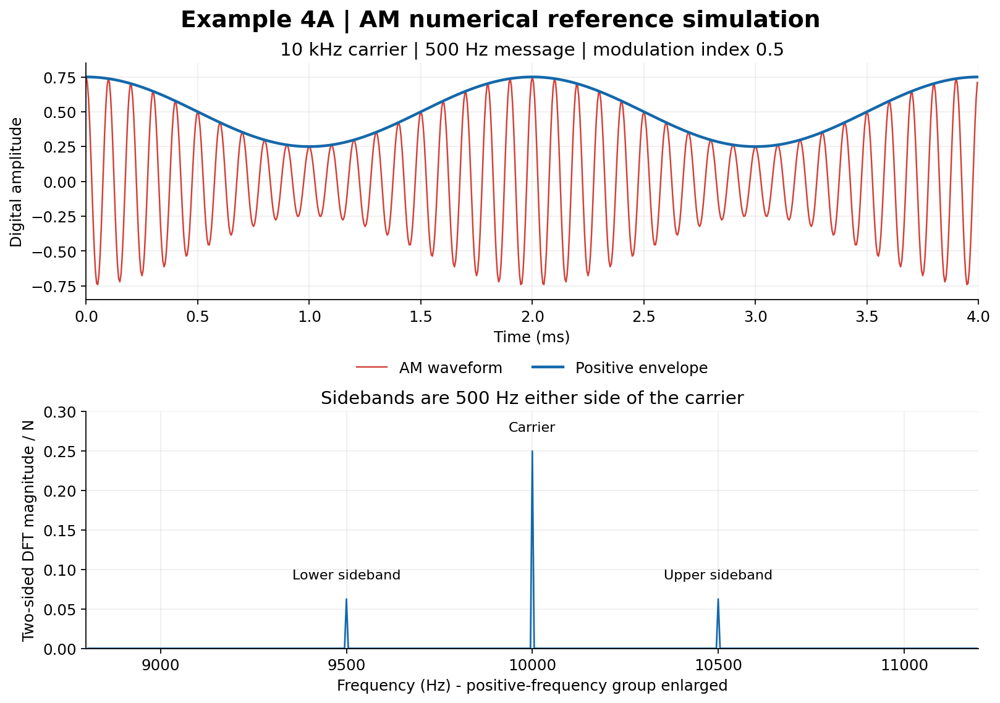

# Pluto SDR Learning Kit

A progressive, practical SDR course preparing the radio-measurement foundation for an indoor robot-tracking graduation project.

**Target environment:** GNU Radio **3.10.12.0**, Python **3.12.9**, Windows 11 Pro, two ADALM-PLUTO devices and two laptops for the hardware link.

**Start in Arabic:** [ابدئي من هنا](START_AR.md) · **Full roadmap:** [START_HERE.md](START_HERE.md)

## What is included?

- Eight progressive examples with **16 editable GNU Radio `.grc` flowgraphs**.
- One or two purposeful GUI panels per flowgraph.
- An English `README.md` for operation, checks and troubleshooting in every example.
- An engineering `REPORT.md` with design rationale, equations, predictions and project connections in every example.
- Short Arabic quick starts, circuit-layout guides and blank measurement worksheets.
- A known audio test clip and Python scripts for numerical references and measurement logging.

## Learning sequence

| Example | Main skill | Start here |
| --- | --- | --- |
| 1. Signal basics | Read time/frequency plots and verify a known signal | [Arabic quick start](Example_01_Signal_Basics/QUICK_START_AR.md) |
| 2. Receiver baseline | Observe noise, existing signals and possible artifacts with TX off | [Arabic quick start](Example_02_RX_Baseline/QUICK_START_AR.md) |
| 3. Known-tone link | Prove reception using TX on/off and deliberate frequency changes | [Arabic quick start](Example_03_Known_Tone/QUICK_START_AR.md) |
| 4. AM tone | Understand the envelope/sidebands, then recover a message | [Arabic quick start](Example_04_AM_Tone/QUICK_START_AR.md) |
| 5. AM audio | Trace sample rates and recover a known audio sequence | [Arabic quick start](Example_05_AM_Audio/QUICK_START_AR.md) |
| 6. Filtering | Select the desired signal and reject an unwanted band | [Arabic quick start](Example_06_Filtering/QUICK_START_AR.md) |
| 7. Power experiments | Compare relative digital power under controlled conditions | [Arabic quick start](Example_07_Power_Experiments/QUICK_START_AR.md) |
| 8. Beacon logging | Save windowed channel-power measurements with metadata | [Arabic quick start](Example_08_Beacon_Logging/QUICK_START_AR.md) |

## First run — no radio needed

1. Download the repository as a ZIP and extract it, or clone it.
2. Open GNU Radio Companion and choose **File → Open**.
3. Open [ex01_signal_basics.grc](Example_01_Signal_Basics/flowgraphs/ex01_signal_basics.grc).
4. Generate and execute the flowgraph. Follow its [README](Example_01_Signal_Basics/README.md).

Examples **1**, **4A** and **6A** are simulations that can be used without Pluto hardware. Before radio experiments, read [COMPATIBILITY.md](COMPATIBILITY.md) and the hardware instructions in the relevant README. The native GNU Radio IIO Pluto blocks are required for the supplied hardware circuits.

## A clear AM reference

The red waveform and blue positive envelope below are an **independent numerical simulation**, not a GNU Radio screenshot or a hardware capture.

## Validation status

The files passed exact-version GRC structure/code-generation checks using runtime stand-ins, independent numerical model checks and isolated Python logger tests. **Actual GNU Radio DSP/GUI execution and Pluto hardware testing have not been performed in the authoring environment.** See [VALIDATION.md](VALIDATION.md) for the exact methods and limits.

Power measurements are relative digital quantities, not calibrated dBm. Host processing timestamps do not establish synchronized RF sample timing. Use the RF setup and frequency approved by the lab; the numeric LO default is a design reference, not authorization to transmit over the air.

## Project handoff

This course prepares the SDR link, signal interpretation, channel selection and measurement logging. Multi-anchor localization, odometry integration, timing/association design, EKF fusion and camera ground truth remain later project stages. Use [FINAL_ASSESSMENT.md](FINAL_ASSESSMENT.md) to check SDR readiness.
